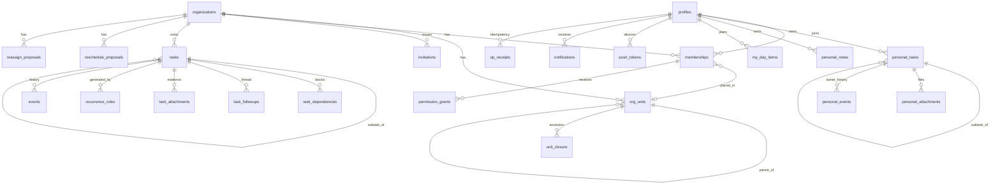

# Database Design (PostgreSQL / Supabase)

> Status: proposal for approval. Behaviors described are intended design. Nothing here has been implemented, executed or validated yet. See TESTING_STRATEGY section 0.

All times `timestamptz` (UTC). IDs `uuid` (v7-style generated client-side for offline creates, validated server-side). Every syncable table: `created_at`, `updated_at`, `row_version bigint` (per-row counter, bumped by trigger, used for optimistic concurrency only, NOT as a sync cursor), `change_xid xid8` (set to `pg_current_xact_id()` by trigger, used by the commit-safe sync cursor, see OFFLINE_SYNC_ARCHITECTURE section 2), `deleted_at` for soft delete (tombstone kept 90 days [DEFAULT]). Tasks also carry `field_versions jsonb`.

## 1. ER diagram

## 2. Tables (core columns)
**profiles** (id = auth.users.id, display_name, avatar_path, locale, theme, timezone, reminder_time, week_start fixed 'sat').
**organizations** (id, name, timezone default 'Africa/Cairo' [DEFAULT], capacity_hours_default 25, created_by).
**org_units** (id, org_id, parent_id null for root, name, depth, leader_membership_id). CHECK parent in same org; trigger blocks cycles (walk ancestors, reject if new parent is self or descendant); root unit per org unique partial index.
**unit_closure** (ancestor_id, descendant_id, depth) PK both; trigger maintained on insert/move; used by RLS helpers.
**memberships** (id, org_id, user_id, role enum[admin,supervisor,team_leader,member], unit_id, status[active,suspended,removed], capacity_hours). UNIQUE(org_id,user_id); UNIQUE(user_id) while [DEFAULT] single org. Role changes only via RPC. At least one active admin per org (deferred constraint trigger).
**permission_grants** (id, membership_id, permission enum, scope_unit_id, expires_at, granted_by, revoked_at).
**invitations** (id, org_id, code_hash (SHA-256 of random 128-bit code), role, unit_id, max_uses, uses, expires_at, revoked_at, created_by). Codes never stored plain; redemption RPC rate-limited.
**tasks** (id, org_id, parent_id, root_id, depth smallint CHECK 0..2, title, description, assignee_membership_id, creator_membership_id, unit_id, priority enum, status enum, planned_date date, deadline_at timestamptz, estimate_min int, is_required bool default true, sort_key text (fractional index), recurrence_rule_id, occurrence_date, completed_at, completed_by, client_completed_at (claim), reopened_count, row_version, field_versions jsonb, change_xid).
 - Constraints: depth = parent.depth+1 (trigger), same org as parent, child assignee within parent's unit authority, status done requires completed_at, UNIQUE(recurrence_rule_id, occurrence_date).
 - Triggers: parent completion gate; progress cache maintenance; dependency cycle check.
 - Indexes: (org_id, assignee_membership_id, planned_date), (org_id, status, deadline_at), (parent_id, sort_key), (root_id), partial (deadline_at) where status not in done/canceled, (change_xid, id) for sync pull.
**task_dependencies** (task_id, blocked_by_task_id) PK; CHECK <>; trigger rejects cycles; same org.
**recurrence_rules** (id, org_id, template fields, weekdays smallint[] in Sat..Fri order, starts_on, ends_on, assignee, active). Edge job materializes 8 weeks ahead idempotently (UNIQUE guard).
**task_followups** (id, task_id, author_membership_id, kind enum[progress,comment,manager_reply,feedback], body, parent_followup_id, edited_at, deleted_at).
**task_attachments** (id, task_id, storage_path, original_name, mime, size, sha256, uploaded_by, replaced_by, status[pending,verified,rejected,removed]).
**events** (id bigint identity, org_id, subject_type, subject_id, task_id, actor_membership_id, kind, payload jsonb, occurred_at default now(), prev_hash, hash). Append-only: REVOKE UPDATE/DELETE, trigger raising on both, partitioned monthly later.
**reschedule_proposals** / **reassign_proposals** (id, org_id, target ids, proposed values jsonb, reason jsonb, status[pending,accepted,rejected,expired], proposed_by (system|membership), decided_by, decided_at).
**notifications** (id, recipient_user_id, kind, subject_id, dedup_key UNIQUE, payload, read_at, push_state).
**push_tokens** (id, user_id, device_id, token UNIQUE, platform, last_seen_at). Owner-only.
**op_receipts** (user_id, op_id uuid, rpc, args_hash, result jsonb, created_at) PK(user_id, op_id): idempotency, written atomically with the mutation (contract in OFFLINE_SYNC_ARCHITECTURE section 8). Retention 90 days.
**user_access_state** (user_id PK, epoch bigint): bumped by triggers on membership/unit/closure/grant changes, drives reconcile mode. **sync_floor** (stream PK, floor_xid): highest purged tombstone xid.
### Personal schema (separate, owner-only)
Decision [DEFAULT, confirm with Peter]: personal tasks have the same capability as team tasks except team-only concepts (assignment, manager visibility, org events). Privacy does not require removing capability, only that no one except the owner can read it.
**personal_tasks** (id, user_id, parent_id, root_id, depth CHECK 0..2, title, notes, priority, status, planned_date, due_date, estimate_min, is_required, sort_key, recurrence_rule_id, occurrence_date, completed_at (server stamped), row_version, field_versions, change_xid, deleted_at). Same depth, gate and cycle triggers as tasks (shared trigger functions parameterized by table).
**personal_task_dependencies**, **personal_recurrence_rules** (same shape as team versions, owner only).
**personal_attachments** (id, personal_task_id, storage_path under `user/{user_id}/...`, name, mime, size, sha256, status). Same validation pipeline, private bucket path owner-only.
**personal_events** (id, user_id, subject_id, kind, payload, occurred_at, prev_hash, hash): owner-only append-only history for personal tasks. It is a separate table and chain from org `events`; never readable by managers or admins, never in analytics or org audit, deleted with the account.
**personal_notes** (id, user_id, body, pinned, row_version, change_xid, deleted_at).
**my_day_items** (id, user_id, day date, task_kind enum[team,personal], team_task_id null, personal_task_id null, state enum[active,removed], removed_at, is_focus, position text, unique (user_id, day, task_kind, coalesce(team_task_id, personal_task_id))). CHECK exactly one id set matching kind. Team reference allowed only when the user can read that task (checked in RPC; dropped on reconcile if lost).
Personal productivity stats (streaks, completion) are computed only for the owner from personal tables/events and are shown only to the owner. They are never joined with team analytics.

## 3. Migration plan (ordered, forward-only)
0001 extensions, schemas, enums. 0002 profiles + auth trigger. 0003 organizations, units, closure, cycle guard. 0004 memberships, grants, invitations. 0005 authz helper functions. 0006 tasks + triggers. 0007 dependencies, recurrence. 0008 followups, events + hash chain. 0009 personal tables. 0010 notifications, tokens, op_receipts. 0011 attachments + storage policies. 0012 proposals. 0013 RPC layer, REVOKEs. Each migration ships with pgTAP tests. Down-migrations not used; fix-forward.

## 4. Integrity rules summary
Explicit FKs with ON DELETE RESTRICT for org-owned data, CASCADE only for personal data on account deletion. Server-controlled columns (completed_at, completed_by, row_version, role, org_id, creator, hash) have no client write path: table writes revoked, RPC sets them. Timestamps from `now()` only.

## 5. Concurrency protection (server)
Isolation is READ COMMITTED with explicit locks. After taking locks every check is re-read.
- **Org structure lock**: `pg_advisory_xact_lock(hashtextextended('org-structure:'||org_id,0))` taken by move_unit, create_unit, set_member_role/move_member (they change authority), add_dependency, reorder across parents, and reassign-with-subtasks. Cycle checks (unit tree walk, dependency graph reachability) run only while holding it, so two concurrent moves cannot each pass the check and together create a cycle. Personal dependencies use a per-user lock the same way.
- **Completion gate and subtask changes**: lock order is always root to leaf (by depth, then id). `complete_task(t)` locks `t` FOR UPDATE, then reads required, not-done, not-deleted descendants and dependencies; it fails with `gate_failed` or completes while holding the lock. `create_task`/`reopen_task`/`set_required`/`move subtask` under a parent lock the parent row FOR UPDATE first, so "complete parent" and "add required subtask" serialize: either the subtask exists when the gate runs, or it is added after completion and then follows the reopen rule (adding a required subtask to a done parent is rejected `parent_done` unless the parent is reopened).
- Child completion that is the last required child does NOT auto-complete the parent (decision [DEFAULT]); progress updates only.
- Triggers repeat the invariants (depth, same org, cycles of closure) as a backstop, but triggers alone are not relied on for race safety.
- Idempotent receipts (section 8 of OFFLINE_SYNC) make retries safe under the same locks.
- Tests: concurrent-session pgTAP/Node harness for each race above.
