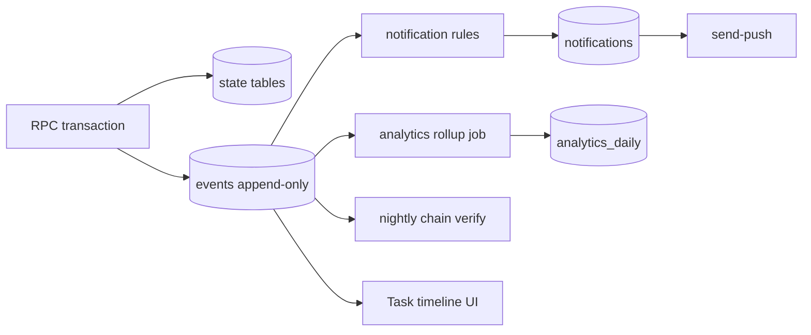

# Event and Audit Model

> Status: proposal for approval. Behaviors described are intended design. Nothing here has been implemented, executed or validated yet. See TESTING_STRATEGY section 0.

## 1. Purpose
One immutable stream serves: task timeline, org audit, analytics inputs (deferrals, reopen counts), notifications and tamper evidence. Personal-space actions are NOT in this stream; they go to the owner-only `personal_events` history (same envelope, separate table and chain, readable only by the owner).

## 2. Envelope
`events(id, org_id, occurred_at, actor_membership_id, actor_kind[user|system], kind, subject_type, subject_id, task_id, payload jsonb, request_op_id, prev_hash, hash)`.
Payload carries before/after of changed fields (ids and values, no secrets). Schema version in `payload.v`.

## 3. Catalogue
| Group | Kinds |
|---|---|
| Task | task.created, task.updated (field diffs), task.deleted, task.restored, task.status_changed, task.completed, task.reopened, task.assigned, task.reassigned, task.priority_changed, task.deadline_changed |
| Subtask | subtask.added, subtask.removed, subtask.reordered, subtask.required_changed, subtask.reassigned |
| Dependency | dependency.added, dependency.removed |
| Recurrence | recurrence.set, recurrence.occurrence_created |
| Follow-up | followup.posted, followup.edited, followup.deleted, manager.feedback, manager.reminder_sent |
| Reschedule | reschedule.proposed, reschedule.accepted, reschedule.rejected, reschedule.expired |
| Rebalance | reassign.proposed, reassign.accepted, reassign.rejected |
| Attachment | attachment.added, attachment.verified, attachment.rejected, attachment.replaced, attachment.removed |
| Org | member.joined, member.role_changed, member.moved, member.removed, unit.created, unit.moved, grant.created, grant.revoked, invitation.created, invitation.redeemed, invitation.revoked |
| Security | auth.denied_burst (aggregated), audit.chain_verified, audit.chain_broken |

## 4. Integrity
- Written only inside RPC transactions via `app_private.emit_event()`.
- REVOKE UPDATE, DELETE, TRUNCATE; BEFORE UPDATE/DELETE trigger raises; table owned by non-app role.
- Hash chain per org: an advisory lock per org serializes the `prev_hash` read, `hash = sha256(prev_hash || org_id || id || kind || canonical_json(payload) || occurred_at)`. This serializes events per org (acceptable at expected volume; load-tested, fallback: per-unit chains).
- Limits: the chain gives tamper evidence against non-privileged modification only. A privileged database operator can rewrite rows and recompute hashes. Daily signed head export to an external write-once store is the proposed mitigation [OPEN]. Do not describe the log as tamper-proof.
- Nightly `verify-audit-chain`; result stored as event.
- Corrections are new events (e.g. followup.deleted), never edits.
- Capture starts in Phase 2 (emit_event and every RPC), long before the timeline UI in Phase 7. Retention: [DEFAULT] indefinite for task events; partition by month; archive after 24 months to cold storage [OPEN].

## 5. Visibility
Task timeline: users who can see the task. Org audit: Admin. Supervisors/leaders: events whose subject is in their subtree. Members never see manager-only notes unless the kind is member-visible (field `visibility` on kind registry).

## 6. Derived data
Analytics read tasks plus events (`task.completed`, `reschedule.accepted`, `task.reopened`). Rollups in `analytics_daily` materialized by idempotent job keyed (org, unit, member, day); recomputable from events.

## 7. Notification mapping
Event kinds -> notification rules table (recipient resolver, dedup_key template, quiet hours). Example dedup: `task.assigned:{task_id}:{assignee}:{version}`.

## 8. Diagram

