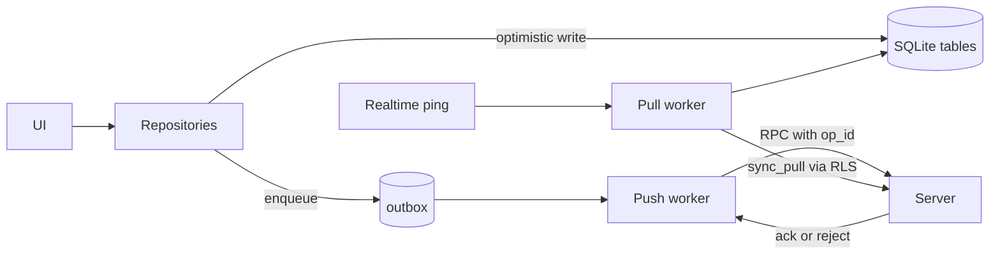

# Offline Sync Architecture

> Status: proposal for approval. Behaviors described are intended design. Nothing here has been implemented, executed or validated yet. See TESTING_STRATEGY section 0.

Status: DRAFT for approval. [DEFAULT] = proposed. [OPEN] = needs a decision.

## 1. Model
Local SQLite is the UI's only read source. Writes are commands in a durable outbox, applied optimistically to local tables. A sync engine pushes commands through RPC and pulls server changes with a commit-safe cursor. Realtime is only a "pull now" nudge.

## 2. Proposed commit-safe change cursor (replaces a global sequence)
Problem with a sequence cursor: a sequence value is assigned at write time, not commit time. Transaction A takes sequence 10, transaction B takes 11 and commits first. A client that pulls up to 11 never sees 10 when A commits later. A global sequence cursor is therefore not used.

Proposed design (NOT yet executed or validated, see section 2.3):
- Every syncable row has `change_xid xid8`, set by a BEFORE INSERT/UPDATE trigger to `pg_current_xact_id()`. Soft deletes are updates, so tombstones carry it too.
- `sync_pull(stream, cursor, session_horizon, limit)` is SECURITY INVOKER (RLS applies). On the first page of a pull session the server computes `horizon = pg_snapshot_xmin(pg_current_snapshot())`: the oldest transaction id that was still in progress. Intended property: every transaction with an id below the horizon had finished when the session started, so no row with `change_xid < horizon` should appear later.
- A page returns rows with `change_xid < horizon` and `(change_xid, id) > cursor`, ordered by `(change_xid, id)`, plus `horizon` and `next_cursor`. The client sends the same `horizon` on every page of the session.
- Re-delivery is allowed: apply is an idempotent upsert guarded by `change_xid` (ignore if the local change_xid is newer).
- The client advances the stored cursor in the same SQLite transaction that applies the page. A session ends on an empty page. The next session starts at rows with `change_xid >= previous horizon` (inclusive).
- Index on `(change_xid, id)` per stream. xid8 is 64-bit.

### 2.1 What the fixed horizon is and is not
The horizon bounds which transaction ids a session may return. It is NOT a persistent MVCC snapshot across pages. Each page is a separate request and statement with its own database snapshot (the API cannot hold one snapshot open across calls). Consequences, to be handled by design and validated:
1. Row updated mid-session before its page: its new `change_xid` is above the horizon, so it drops out of this session's range. This session never delivers that row (neither old nor new version). The next session delivers the new version. The client may therefore lack a row until the next session.
2. Row already delivered, then updated: next session re-delivers the new version.
3. Cross-row consistency: parent and child rows (task and subtask, task and follow-up) may arrive from different moments. The client must tolerate orphans (child before parent, or parent missing): hold such rows as `incomplete` and do not show them as consistent until a later session completes, or show with a pending marker. Foreign keys are not enforced in the local mirror.
4. RLS is evaluated per page. Access can change between pages, handled by the epoch check on every page (section 3).
5. Long-open transactions hold the horizon back. Visibility of newer rows is delayed, and a session with a very old horizon may return the same bounded range repeatedly while newer commits wait. Needs a monitoring limit and a maximum transaction age on the server (statement and idle-in-transaction timeouts).
6. Clients must treat "sync complete" as eventual: a session finishing is not a consistent snapshot of the database. The UI reads local data and shows sync state.

### 2.2 Why this is intended to avoid skipped rows
A row becomes eligible only after its transaction id is below a horizon computed from the set of in-progress transactions at session start. An in-progress transaction has an id at or above the horizon, so it is excluded, and when it later commits its rows have ids at or above the horizon and are returned by a later session. Intended conclusion: no committed row is skipped across sessions. This is a design argument, not a verified result.

### 2.3 Required validation before this design is relied on (none executed yet)
- A real Postgres/Supabase test: hold a write transaction open, commit later-started transactions, pull in multiple pages and sessions, commit the first transaction, and assert it is delivered in a later session and nothing is lost.
- Concurrent update during a multi-page session (cases 1 to 3 above) with assertions that the client converges and orphans resolve.
- Behavior with subtransactions, prepared transactions, aborted transactions, replication lag on read replicas (not used by default), and Supabase pooling modes.
- Performance at 50k to 500k rows per stream and under long-running transactions.
- Review by an independent Postgres expert. Fallback if validation fails: an explicit server-side change log table written in the same transaction with the same horizon rule, or a managed sync layer (ADR fallback).

## 3. Access changes: revocation and grant backfill (proposed, validation required)
A delta feed by change_xid cannot see rows that become visible because access changed (old rows, old change_xid), nor rows that stopped being visible.
Visibility inputs to cover (each must bump an epoch or emit an access tombstone):
- membership status, role, unit; unit tree moves (closure changes); permission grants;
- task visibility changes: assignee change, task unit change, creator or delegation change, parent change (subtask moved), soft delete or restore, attachment or follow-up visibility, and My Day references to team tasks the user may lose.
Mechanism:
- `user_access_state(user_id, epoch)` for per-user inputs, plus `scope_epochs(unit_id, epoch)` for unit-scoped inputs. The epoch a client sees is `max(user epoch, scope epochs of units within the user's authority subtree)`, computed server-side and returned on every pull page and push response.
- A task update that changes assignee, unit or deletion bumps the user epoch of the former assignee and the scope epoch of the former unit (and of the new unit, so newly authorized viewers backfill). Cost: extra writes per such update, evaluated in validation.
- Client stores its epoch. Any mismatch starts **reconcile mode** for the affected streams:
  1. Backfill: pull from cursor zero under current access (idempotent upserts).
  2. Inventory: page `list_visible_ids(stream)` into a local staging table with the same horizon rule. The inventory is complete only when the final page arrives AND the epoch reported on every page, including the last, equals the epoch the reconcile started with.
  3. If the epoch changes at any point during backfill or inventory, discard the staging data and restart reconcile with the new epoch. Never purge from a partial or unstable inventory.
  4. Purge: only after a complete stable inventory, delete local rows not in the inventory whose local `change_xid` is below the inventory horizon (newer local rows are kept). Cached files for purged rows are removed. Pending outbox ops targeting purged rows become `rejected(access_revoked)` and appear in the Sync Inbox.
  5. Only then store the new epoch. An interrupted reconcile resumes only if the epoch is unchanged, otherwise restarts.
- Immediate server effect: RLS is evaluated per request, so a revoked user cannot pull new data before the client reconciles. Data already cached on a device remains readable offline until reconcile (residual risk, listed in SECURITY).
- Optimization (unit-scoped backfill) deferred. [DEFAULT: full stream reconcile]
Required validation: grant, revoke, unit move, task reassignment and task move scenarios against real Supabase RLS, including epoch changes mid-reconcile.

## 4. Tombstones and retention
- Deletes are soft (`deleted_at` + new change_xid). Tombstone rows are kept at least 90 days [DEFAULT]. Consistent with the 80-day op expiry above.
- Purge job hard-deletes tombstones older than retention and records `sync_floor_xid` (the greatest change_xid purged) per stream.
- If a client cursor is below `sync_floor_xid`, the server answers `full_resync_required`. The client first tries to push its outbox, then runs a full resync (same as reconcile mode). Offline for more than 90 days is therefore safe but costs a full resync.
- `op_receipts` retention equals tombstone retention (see section 8).

## 5. Account isolation
One SQLite file per user id (`tf_{userId}.db`), key in secure-store. Sign-out stops the engine, queues push-token deletion, and wipes the file unless the outbox is non-empty, in which case the user is warned and may export or keep it locked to that account. Accounts never share files or caches.

## 6. Local schema (sketch)
- Mirror tables for every syncable stream (tasks, followups, units, members, my_day_items, personal_* tables, notifications read state, attachment metadata). Each row: `sync_state` [synced, pending, conflict, rejected], `change_xid`, `base_version`.
- `outbox(seq PK AUTOINCREMENT, op_id UNIQUE, rpc, entity_type, entity_id, args_json, args_hash, base_version, created_at, attempts, next_attempt_at, state[queued,inflight,acked,rejected,dead], error_code, depends_on_seq)`.
- `sync_state(stream, cursor_xid, cursor_id, epoch, floor_seen)`; `conflict_log`.

## 7. Operation ordering
Strict FIFO per entity and by `seq` for dependent ops (task before its subtasks, attachment after task). Independent entities may be sent in parallel (max 5) but results are applied in `seq` order. `depends_on_seq` is set automatically when an op references an entity created by a queued op. Client-generated UUIDs allow create plus children offline. If a parent op is rejected, dependent ops are rejected with `parent_rejected` (visible).

## 8. Idempotency receipts (server contract, used by every mutating RPC)
Table `op_receipts(user_id, op_id, rpc, args_hash, result jsonb, created_at)` PK `(user_id, op_id)`.
1. Atomic with the mutation: the RPC runs in one transaction. First statement: `INSERT INTO op_receipts ... ON CONFLICT (user_id, op_id) DO NOTHING`, with `result` null. The mutation, its events, and the final `UPDATE op_receipts SET result = ...` commit together. If anything fails, everything rolls back including the receipt.
2. Concurrent retries: a second transaction inserting the same key blocks on the unique index until the first commits or aborts. If the first commits, the insert does nothing and the second reads the stored result and returns it (no second effect). If the first aborts, the second inserts and executes normally.
3. Argument mismatch: if a receipt exists with different `rpc` or `args_hash` (SHA-256 of canonical JSON of arguments excluding op_id), return `op_id_reuse` and apply nothing. The client treats it as a bug (op marked `dead`, logged, visible).
4. Rejections: business rejections roll back, so no receipt is stored. The client marks the op rejected on first response and never auto-retries it. A user "Retry" creates a new op_id with the re-evaluated arguments. Network failures (no response) are retried with the same op_id, which is safe by points 1 to 3.
5. Retention 90 days [DEFAULT]. Expired receipts must never let an old op replay blindly. Proposed rule:
   - Each op carries `enqueued_at` (client claim). The server rejects any op whose `enqueued_at` is older than the receipt retention window minus a safety margin (default 80 days) with `op_expired`, before any mutation. A dishonest client can only act within its own authority, equivalent to sending a fresh op.
   - Before sending, the client classifies queued ops older than 60 days: it calls `classify_ops(op_ids)`, which returns `applied` (receipt exists) or `unknown`. `unknown` ops are NOT replayed. They move to the Sync Inbox as "stale, needs review" with the user's original input. The user can resend as a new op with a new op_id after the app re-evaluates it against current state.
   - Creates with a client-generated id: if the id already exists and belongs to the same user, the server treats the op as already applied only when the receipt exists; otherwise `op_expired` or a conflict, never a silent merge.
   - Receipts are purged only after their ops can no longer be accepted under the `enqueued_at` rule.

## 9. Retry strategy
Network error, timeout, 5xx: exponential backoff (2 s base, x2, full jitter, cap 5 min), never gives up, visible "waiting" state. 401: pause push, refresh the token; if refresh fails show "session expired", keep outbox and local data readable, writes still queue. 4xx business error: no retry, state rejected.

## 10. Server rejection handling (nothing disappears silently)
Rejected op: local state is reverted to server state or marked "needs attention" by kind. A Sync Inbox entry stores reason, the user's original input, and actions: Resend as new op, Edit and resend, Discard (confirm; discard written to a local log). Tab badge shows the count. Typed errors: forbidden, not_found, stale_conflict, gate_failed, dependency_blocked, cycle_detected, focus_limit, access_revoked, parent_rejected, validation, quota, op_id_reuse.

## 11. Conflict resolution (single consistent policy)
Server keeps `field_versions jsonb` on tasks: for each field, the `row_version` at which it last changed. A patch op carries `base_version`. For each patched field the server compares `field_versions[field]` with `base_version`:
- not changed since base: apply.
- changed since base and new value equals current: no-op success.
- changed since base and value differs: reject `stale_conflict`. Applies to team task title, description, priority, deadline, planned date, estimate. The client shows a conflict card with both versions (theirs, yours) and resolves by sending a new op with a new base_version. No silent overwrite.
- Non-conflicting fields in the same patch from different people merge (disjoint fields).

| Data | Policy |
|---|---|
| Team task text and scalar fields | field-level compare-and-set above |
| Status | server state machine; done on done is idempotent success; illegal transitions rejected |
| Completion | first completion wins, later ones are no-op success |
| Reassignment | server authority; stale assignee -> stale_conflict |
| Ordering of subtasks/lists | see section 12 |
| Delete vs edit | delete wins; the edit is rejected with explanation |
| Follow-ups | append-only, no conflicts; edits/deletes are new events on one row, soft |
| Personal data (single owner, multiple devices) | last write wins in server arrival order per field; losing values are kept in the owner-only personal history |
| My Day | per-item register, see section 13 |

## 12. Ordering
Lists use string keys from a fractional-indexing scheme plus `id` as a deterministic tiebreaker. This is NOT conflict-free: two devices inserting between the same neighbors can generate equal or interleaved keys, and keys grow with repeated insertions at the same spot. Guarantees we do make: total, deterministic order on every device (key, then id); a reorder is a last-arrival-wins write to one row's key; never causes data loss. A background `rebalance_keys` job (server-side, per parent, under the parent row lock) rewrites keys when length exceeds 32 chars or on collision; it emits change rows so clients converge.

## 13. My Day semantics
Each (user, day, item reference) is one row with a state register: `active` or `removed` (tombstone with `removed_at`), `is_focus`, `position`. Operations are explicit and applied in server arrival order: `my_day_add`, `my_day_remove`, `my_day_set_focus`, `my_day_move`. There is no "replace whole list" RPC. Add after remove revives the row; remove after add removes it; they do NOT commute, so the last arriving op wins and the result is the same on all devices after sync. Focus limit (3) enforced at the server: the later focus op beyond the limit is rejected `focus_limit` and appears in the Sync Inbox. Items referencing tasks the user can no longer read are dropped on reconcile with a visible note.

## 14. Concurrency on the server (supports offline replay)
Offline replay makes concurrent, arbitrary-order requests normal. Rules (details in DATABASE_DESIGN section 5): per-org structure lock for unit moves, dependency edits and cycle checks; ordered row locks for completion gates and subtask changes; all re-checks happen after the locks are held.

## 15. Pull and initial sync
Initial sync is paged and resumable, loading current week +/- 4 weeks first, the rest in the background, each page applied atomically with its cursor. Corrupt DB (integrity check) offers reset from server after exporting the outbox to a backup file.

## 16. Attachments offline
File copied to app storage, row `pending`, resumable upload job separate from the outbox but keyed by the same op_id idempotency, visible states, size/type checks locally and on the server.

## 17. Offline support table
| Operation | Offline? | Notes |
|---|---|---|
| View tasks, My Day, personal space, follow-ups | Yes | within cached window |
| Create/edit/complete/reopen own tasks | Yes | gate checked locally, rechecked at server |
| Create subtasks, reorder | Yes | |
| Post follow-up | Yes | pending state |
| Plan My Day, personal tasks/notes/subtasks/recurrence | Yes | |
| Assign/reassign others | Queued | server may reject |
| Approve reschedule/reassign proposals | Queued | proposals may have expired |
| Generate reschedule/workload suggestions | Local estimate labeled "estimate" from cached data; authoritative on sync [OPEN] | |
| Team Pulse, analytics | Cached last result with age label | |
| Sign-up, first sign-in, reset password | No | |
| Redeem invitation, create org | No | |
| Roles, invitations, unit management, grants | No | security sensitive |
| Send gentle reminder | No | avoids stale nudges |
| Download uncached attachment | No | |
| Upload attachment | Queued | |
| Push token registration | Queued | |

## 18. Server time and offline completion
`client_completed_at` is stored as a claim; `completed_at` = server receipt time. When the claim is more than 24 h before receipt the UI shows "completed offline on {date}". Metrics use `completed_at` [DEFAULT]. [OPEN] Whether managers may count the claim for on-time metrics.
