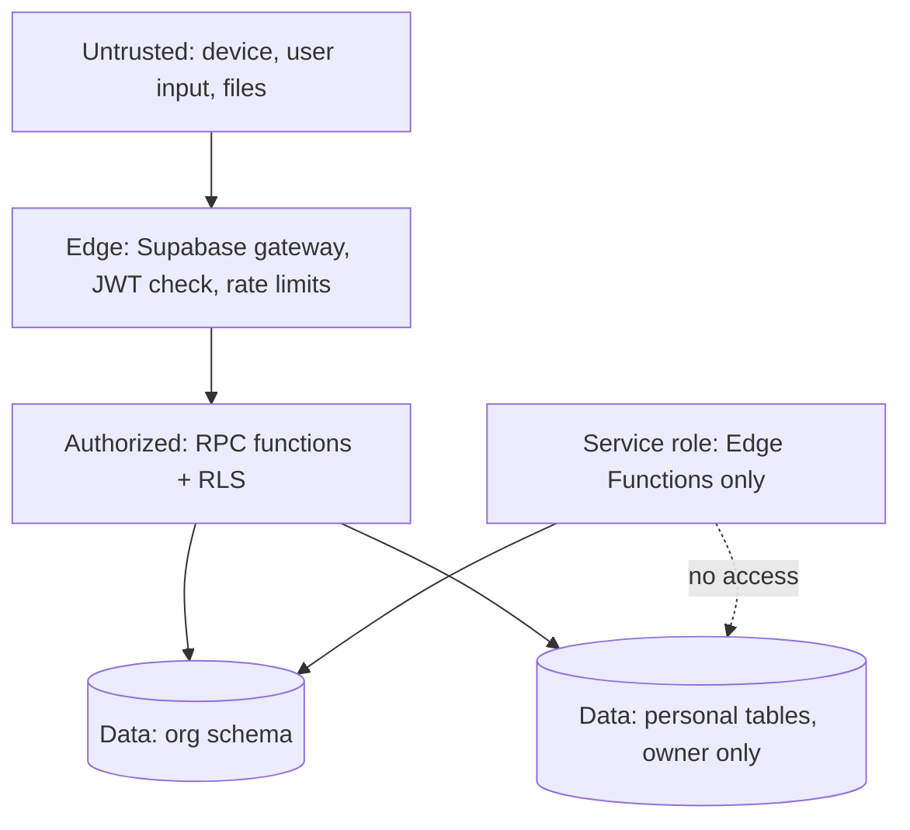

# Security Architecture

> Status: proposal for approval. Behaviors described are intended design. Nothing here has been implemented, executed or validated yet. See TESTING_STRATEGY section 0.

## 1. Principles
Deny by default. Server decides. Mobile holds only anon key. Least privilege. Every mutation audited. Personal space is structurally separate from org views (separate tables, no policies granting managers).

## 2. Trust boundaries

Service role never leaves Supabase/Edge secrets. Edge Functions touching personal data limited to the owner's own daily summary, run with a narrowly scoped DB role.

## 3. Authentication
Supabase Auth email/password, email verification required before org join/create, password min 10 chars + breach check [DEFAULT via Auth setting], short JWT (1 h) with refresh rotation and reuse detection, session in expo-secure-store. Sign-out deletes push token and wipes account-scoped local DB. Optional MFA (TOTP) for Admins [OPEN].

## 4. Authorization
- RLS enabled and forced on every table. Policies call `app_private` helpers: `is_member(org)`, `role_of(org)`, `has_authority_over(target_membership)` (via unit_closure: actor leads/supervises an ancestor unit of target's unit), `has_grant(permission, unit)`.
- Authority rule: authority flows down the tree only. A leader cannot act on peers or ancestors. Admin has org-wide authority except personal space.
- Helper functions SECURITY DEFINER with `search_path = ''`, owned by a non-login role, EXECUTE revoked from PUBLIC.
- All mutations are RPC; `authenticated` has no INSERT/UPDATE/DELETE on org tables.
- Server-controlled fields never accepted from client.
- Role escalation checks: cannot grant role >= own; cannot remove last admin; cannot demote self below admin if last.

## 5. Data protection
TLS only. Supabase at-rest encryption. Local SQLite: [DEFAULT] encrypted with SQLCipher-capable build if Expo support verified at kickoff, otherwise OS file protection plus secure-store key and documented residual risk [OPEN]. Logs scrub PII. No task content in push payloads by default (title only if user opts in).

## 6. Storage
Private buckets only. Path `org/{org_id}/task/{task_id}/{attachment_id}`. Storage RLS calls the same authority helpers. Downloads via signed URLs, 60 s. Upload: pending row via RPC, direct upload to a quarantine path, Edge Function validates magic bytes, size, type allowlist, strips metadata for images, then marks verified and moves. SVG and executables rejected. Filenames never used as paths.

## 7. Abuse controls
Rate limit RPC per user (auth endpoints per IP). Invitation redemption: 5 tries/hour, constant-time compare on hashes. Gentle reminder caps. Payload size limits. Idempotency receipts block replay amplification.

## 8. Push tokens
Bound to user + device; upsert via RPC with current JWT; token reassign on device handoff removes old row; pruned on invalid receipt; never readable by other users.

## 9. Audit integrity
Events append-only (privilege + trigger), hash chain `hash = sha256(prev_hash || canonical payload)` per org, verification function run nightly, mismatch alerts the ops channel. Scope of the guarantee: detects accidental corruption, application bugs, and tampering by roles that cannot rewrite the whole chain. A privileged DB operator can recompute the chain; mitigation is a daily chain-head export signed with a key held outside the database to a separate write-once store [OPEN]. Until anchoring is configured the system must not claim tamper-proof logs.

## 10. Threat model (STRIDE highlights)
| Threat | Control |
|---|---|
| Member reads another's personal data | owner-only RLS on all personal_* tables including history and attachments, no definer functions touching them except owner-scoped |
| Manager peeks at My Day | my_day_items owner-only; team views never join it |
| Forged completion time | server stamps completed_at |
| Client sets role/org_id | no direct writes; RPC derives from JWT |
| IDOR on attachment | storage policy + signed URL per request |
| Hierarchy cycle to gain authority | trigger + closure rebuild tests |
| Replayed outbox op | op_receipts PK + args_hash mismatch rejection |
| Race creating cycles or bypassing completion gate | advisory structure lock, ordered row locks, re-check under lock |
| Access revoked but data cached on device | epoch-triggered reconcile purge, server RLS blocks new reads immediately; locally cached data on a still-enrolled device remains until reconcile (residual risk, mitigated by short epoch check on every request) |
| Stolen device | sign-out wipe, secure-store, remote session revoke |
| Privilege via SECURITY DEFINER misuse | empty search_path, explicit schema qualification, lint in CI |
| Leaky Realtime payload | realtime sends ids only, data pulled through RLS |

## 11. Security testing
Negative test suite: for every table and RPC, a matrix of (anonymous, other-org user, member, leader of other unit, leader of unit, supervisor, admin) x (select, insert, update, delete, call). Expected results asserted in pgTAP. CI fails on any RLS-disabled table, any definer function without fixed search_path, any grant to PUBLIC. Dependency audit, secret scanning, mobile static analysis (MobSF), pen-test before release.
