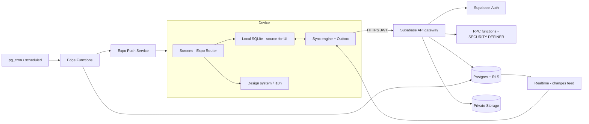
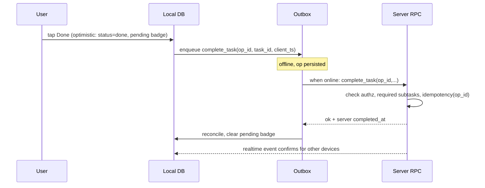

# System Architecture

> Status: proposal for approval. Behaviors described are intended design. Nothing here has been implemented, executed or validated yet. See TESTING_STRATEGY section 0.

## 1. Shape
Mobile client (Expo / React Native / TypeScript) talking only to Supabase (Auth, PostgREST, RPC, Realtime, Storage, Edge Functions). No custom server to run. Business rules live in Postgres (constraints, triggers, SECURITY DEFINER RPC). Edge Functions only for scheduled and external-facing work (push, daily summaries, file validation).

## 2. Layers (client)
1. app/ routes (expo-router).
2. features/ (tasks, myday, team, followups, analytics, settings), each with screens, hooks, local queries.
3. data/ local DB schema, repositories, sync engine, outbox, realtime listener.
4. ui/ design system components and tokens.
5. core/ auth session, i18n, time (Sat-Fri week), errors, logging.
Rule: screens read only from local repositories and write only by enqueuing commands. Screens never call Supabase directly.

## 3. Layers (server)
- Schema namespaces: `app` (tables), `app_private` (helpers, not exposed), `app_api` (RPC exposed). Only `app_api` functions and a small set of RLS-guarded read tables are exposed to the API.
- Writes: all mutations through RPC. Direct INSERT/UPDATE/DELETE on tables revoked from `authenticated`. Rationale: one place for validation, idempotency, event emission, server-controlled fields.
- Reads: RLS-protected SELECT on tables for sync pull and realtime; analytics via RPC/views.
- Events: every RPC writes domain events in the same transaction.

## 4. Key flows
### 4.1 Complete a task offline (see OFFLINE_SYNC for receipts and conflicts)

### 4.2 Assignment with notification
Manager RPC assign_task -> row update + task_assigned event -> notification row (dedup key) -> Edge Function sends push -> assignee device pulls delta.

### 4.3 Daily summary
pg_cron every 5 min -> Edge Function finds users whose local reminder minute passed and no summary sent today (unique key) -> builds summary from their visible data -> push.

## 5. Component choices (evaluated in ARCHITECTURAL_DECISIONS.md)
| Concern | Choice [DEFAULT] |
|---|---|
| Framework | Expo managed + dev client, current stable SDK at kickoff, New Architecture on |
| Routing | expo-router |
| Local DB | expo-sqlite (SQLCipher not default, see Security) |
| Local query layer | thin typed SQL repositories (Kysely-style builder optional) |
| Sync | custom outbox + commit-safe pull (xid8 horizon cursor), no third-party sync service |
| Server state libs | none beyond sync engine; TanStack Query only for non-synced calls (analytics) |
| UI state | Zustand for ephemeral UI only |
| Forms | react-hook-form + zod (shared schemas) |
| i18n | i18next + expo-localization, RTL via I18nManager with restart handling |
| Dates | Temporal-style helpers over date-fns-tz, org timezone aware |
| Lists | FlashList |
| Animation | Reanimated, minimal |
| Push | expo-notifications + Expo Push Service |
| Secure storage | expo-secure-store for session and DB key |
| Monorepo | pnpm workspace: apps/mobile, packages/shared (zod schemas, constants), supabase/ (migrations, functions, tests) |
| CI | GitHub Actions + EAS Build/Update |
Dependency vetting rule: each added package needs Expo SDK compatibility check, maintenance check (release in last 12 months), license, and a recorded ADR line.

## 6. Environments
local (Supabase CLI docker) -> staging project -> production project. Migrations only via CLI, forward-only, reviewed. Secrets in EAS/Supabase secrets, only anon key and URL in the app.

## 7. Architectural conflicts identified up front
| # | Conflict | Resolution proposed |
|---|---|---|
| 1 | Offline-first optimistic completion vs server-trusted timestamps | Store client_ts as a claim, server stamps completed_at at sync receipt, UI shows "completed (syncing)". Analytics use server time; also keep claim for dispute view. [OPEN: policy for long offline periods] |
| 2 | Required parent gate vs offline edits by two users | Gate evaluated at server on replay; rejection surfaces as a visible conflict item, op not lost |
| 3 | Strict personal privacy vs My Day mixing team and personal tasks | Separate tables; My Day is a private table referencing either by typed pair; server never joins personal into team views |
| 4 | RLS-only reads vs Realtime filter limits | Realtime delivers only a ping (table, id); client then runs the commit-safe pull through RLS. Avoids leaking via payload filters |
| 5 | Hierarchy scope checks cost vs query speed | Closure table `unit_closure` maintained by trigger, indexed, used in RLS helper |
| 6 | Audit immutability vs GDPR delete | Events store user ids not content PII; deletion pseudonymizes user row, events remain |
| 7 | Expo push tokens vs multi-device and sign-out | Token table per device, deleted on sign-out RPC, unique token constraint, server prunes on push receipts error |
| 8 | Custom sync vs adopting PowerSync/WatermelonDB | Custom chosen for Supabase RLS fidelity and no extra service. Risk is real: a spike in Phase 3 proves the commit-safe cursor, access reconcile and idempotency against a real Supabase before features depend on it; fallback ADR if the spike fails |
| 11 | Delta cursor vs commit order | change_xid with snapshot horizon, not a global sequence (OFFLINE_SYNC section 2) |
| 12 | Access change vs delta feed | per-user access epoch, backfill plus purge reconcile |
| 13 | Concurrent structure edits | advisory structure lock plus ordered row locks |
| 9 | Recurring tasks: rule vs materialized rows | Rule table plus materialized occurrences for the next 8 weeks, so offline and analytics work on plain rows |
| 10 | Arabic RTL layout restart requirement on RN | Direction follows language at first launch choice; switching prompts one-time reload; documented in UI doc |
