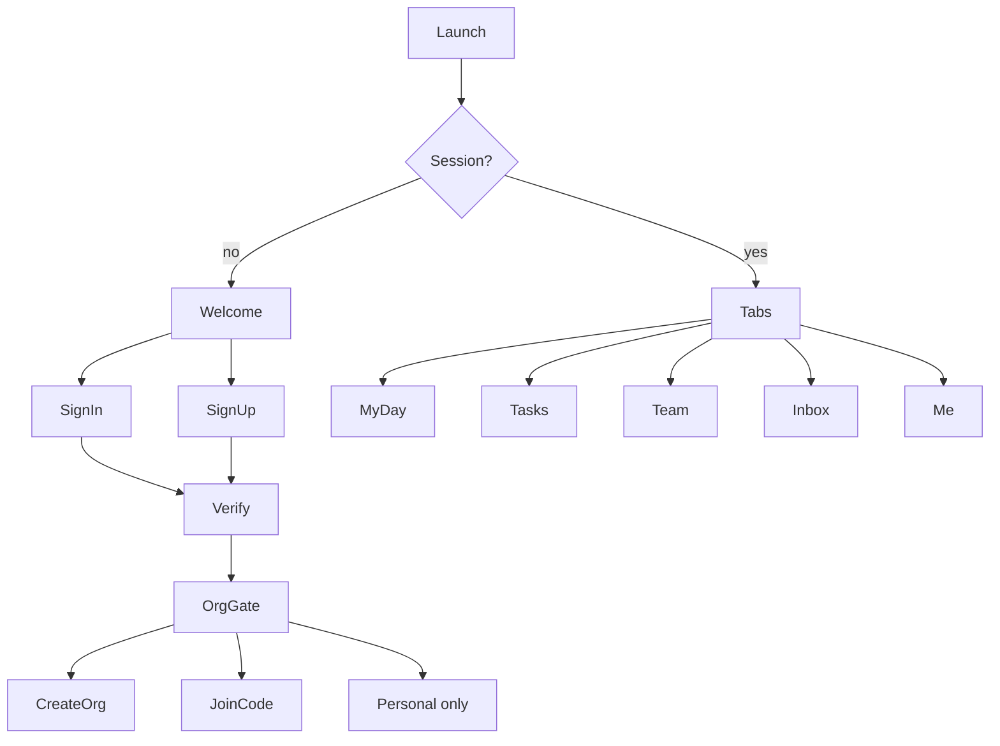
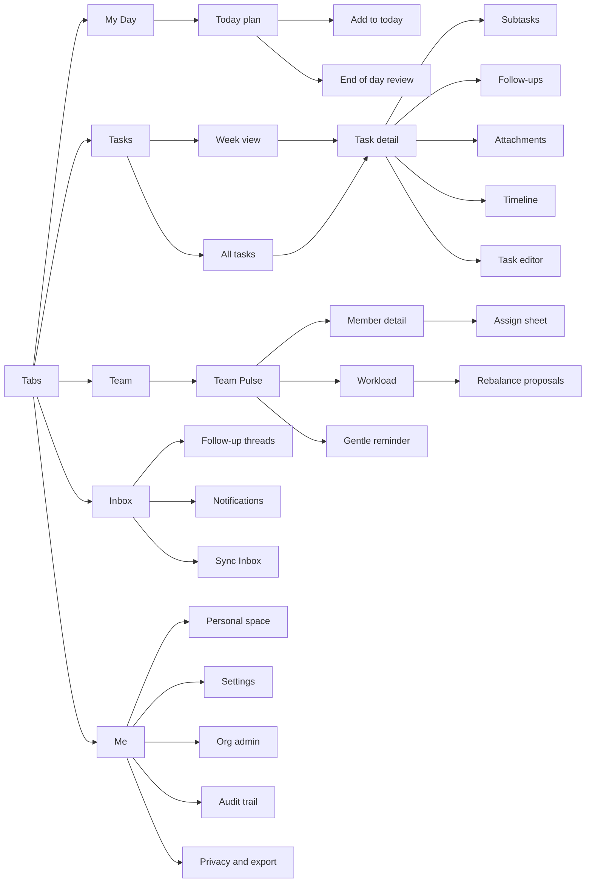

# UI/UX and Design System

> Status: proposal for approval. Behaviors described are intended design. Nothing here has been implemented, executed or validated yet. See TESTING_STRATEGY section 0.

Philosophy: "Powerful functionality. Almost effortless interaction." One primary action per screen, progressive disclosure, calm surfaces.

## 1. Brand tokens (proposed, final values after contrast testing)
| Token | Light | Dark |
|---|---|---|
| primary (deep teal) | #0F5C63 | #4FB3BA |
| primary-pressed | #0B464C | #7CCBD0 |
| accent (marigold) | #F2A900 | #FFC24D |
| bg | #F6F5F1 | #0E1517 |
| surface | #FFFFFF | #162023 |
| surface-glass (overlays only) | rgba(255,255,255,.72) | rgba(22,32,35,.72) |
| border | #E3E1DA | #26363A |
| text | #141B1D | #ECF1F1 |
| text-muted | #5B6769 | #9AAAAD |
| success | #2E7D5B | #5DC49A |
| warning | #B26A00 | #FFB454 |
| danger | #B3261E | #FF8A80 |
Marigold is used sparingly: focus items, streak, key highlights. All text pairs must be measured against AA (4.5:1, large text 3:1) before the values are final; not yet measured.

## 2. Typography
Cairo (Arabic + Latin) via expo-font, weights 400, 500, 600, 700. Scale: display 28/36, title 22/30, heading 18/26, body 16/24, caption 13/18, line heights increased 10% for Arabic. Respect OS font scaling up to 200%. Tabular numerals for counts and times.

## 3. Spacing, shape, elevation
4 pt grid (4, 8, 12, 16, 24, 32). Radius: 8 controls, 14 cards, 20 sheets. Cards: 1 px border, no shadow by default; one soft shadow level for floating elements. Glass: only bottom tab bar and sheets header, never on content cards, never stacked. No decorative gradients; one subtle teal tint behind progress rings at most.

## 4. Components
Button (primary, secondary, ghost, danger), IconButton, TaskRow (checkbox, title, meta chips, sync state dot), TaskCard, SubtaskTree (indent max 2), ProgressRing and ProgressBar (teal fill, marigold overdue-risk marker), PriorityPill, StatusChip, WeekStrip (Sat to Fri), DayHeader, Avatar, MemberRow with load bar, FollowupBubble, TimelineItem, EmptyState (illustrated minimal line art), SyncBanner, ConflictCard, Sheet, Dialog, Toast, SegmentedControl, Field (text, date, time, picker), SwipeActions, SkeletonLoader, PermissionLock notice.
Rules: logical properties only (start/end), icons that imply direction mirror in RTL, numbers and Latin runs isolated with bidi marks.

## 5. Navigation
Bottom tabs (5): **My Day**, **Tasks**, **Team** (hidden for Members without team-view rights, replaced by **Space** only if needed), **Inbox** (follow-ups, notifications, Sync Inbox), **Me** (personal space, settings). [DEFAULT]. Floating "+" quick add on My Day and Tasks.

## 6. Screen map
- **Auth**: Welcome, Sign in, Sign up, Verify email, Reset password, Org gate (create / join with code / personal only).
- **My Day**: Today plan (focus slots, list), Add to today picker, End-of-day review (carry-over suggestions), Quick add sheet.
- **Tasks**: Week view (Sat-Fri strip + day list), All tasks (filters: status, priority, assignee, due), Task detail (header, progress, subtasks tree, dependencies, follow-ups, attachments, timeline tabs), Task editor, Subtask editor, Recurrence editor, Reschedule proposals review.
- **Team** (leaders+): Team Pulse (overview cards, member list with load bars), Member detail (tasks, progress, trend), Assign sheet, Workload and rebalance proposals, Gentle reminder sheet, Team analytics.
- **Inbox**: Follow-ups threads, Notifications, Sync Inbox (rejected/conflict items).
- **Me**: Personal space (tasks with subtasks, recurrence, attachments, history; notes), Profile, Notification settings (reminder time), Language and theme, Org: members, units tree, invitations, roles and grants (Admin), Audit trail (Admin), Privacy and data export, Sign out.
- **System**: Offline banner, Session expired sheet, Forced update, Permission denied view.

### Screen map diagram

## 7. Key journeys
1. First run: sign up -> verify -> join with code -> land on My Day with 3 sample prompts -> add first task in under 30 s.
2. Daily: open My Day -> pick focus 3 -> tick off -> end-of-day review accepts carry-over.
3. Manager: Team Pulse -> tap overloaded member -> see suggestions -> approve one move -> member notified.
4. Offline: complete tasks in a tunnel, pending dots, banner, reconnect -> dots clear; a rejection lands in Sync Inbox with explanation.
5. Evidence: open task -> attach photo -> upload state -> verified.

## 8. Interaction rules
Swipe to complete, long press multi-select, haptics light only on completion. Animations 150 to 250 ms, reduce-motion respected. Destructive actions: undo toast first, confirm only when irreversible. Loading uses local data instantly; never block on network.

## 9. Accessibility and i18n
Screen reader labels in both languages, focus order follows reading direction, 44 pt targets, color never sole signal (icons + text for status), contrast tested light and dark, dynamic type to 200%. Arabic first-class: copy written natively (not machine translated), reviewed by native speaker [OPEN: who]. Pseudo-localization test pass in CI.

## 10. Responsive
Phone portrait primary. Tablet: two-pane (list + detail), max content width 720 in single pane. Landscape supported.
